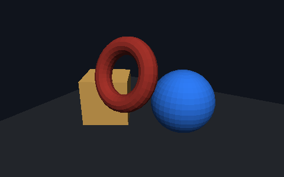

## Native-language direction

The evolution plan for a less Rust-shaped language, runtime-interpreted types, a more distinctive syntax, and the ZAP package manager is tracked in [the native-language roadmap](docs/native-language-roadmap.md). This direction preserves existing Z#++ compatibility while developing a more native Zsharpend dialect and tooling.


# z-nd — Zsharpend

**Zsharpend** is the next Z#++: a small, sandboxed, embeddable scripting language whose programs are `.zxx` files, compiled and run by **Whetstone**. It keeps everything Z#++ (and Sam-astro's Z#) could do — `.zsp`, `.zsx` and `.zsg` files load unchanged — and adds:

- **Python**: comprehensions, slices, unpacking, keyword arguments, decorators, `elif`, `not in`, `None`/`True`/`False`, `@` for matrix multiplication.
- **Rust**: `fn`, enums with data and destructuring `match`, traits (checked), `Ok`/`Err`/`Some` with `?`, `loop`, `let mut`, sized integers.
- **HolyC**: printing statements with printf formats, bare-name calls, `switch` with `case a...b:` ranges, `I64 F(I64 x)` declarations, `U0`…`F64`, `#include`.
- **nd**: NumPy-style n-dimensional arrays — broadcasting, slicing, masks, reductions, `@`.
- **gfx3d**: meshes, a camera and a z-buffered software renderer onto the 2D canvas.
- **Modules, extensions and script extenders**: `import name` (project, installed, or from Rust), `.zxx` extensions with event hooks, and an `Extender` trait for native plugins that add modules and rewrite code.
- **Whetstone**, the compiler: every project has a `.wtf` (Whetstone Translation File) saying how to compile it; Whetstone parses everything the program reaches, checks the whole program (undefined names, arity, constants, enum variants, printf formats, traits, unused and unreachable code), writes a self-contained bundle, and runs it. Projects can target StonedGem's extension API (`host = "stonedgem"`).



```sh
cargo install --path crates/whetstone
whetstone new hello && cd hello && whetstone run
```

## Crates

| Crate | What it is |
|---|---|
| [`zsharpend`](crates/zsharpend) | The language: lexer, parser, interpreter, standard library, canvas, `.zsg` GPU code, modules, the `Extender` trait. Same host API as Z#++. |
| [`zsharpend-nd`](crates/zsharpend-nd) | The `nd` script extender. |
| [`zsharpend-3d`](crates/zsharpend-3d) | The `gfx3d` script extender. |
| [`zsharpend-os`](crates/zsharpend-os) | The `os` script extender: terminal, processes, files and environment, for programs that leave the sandbox. |
| [`whetstone`](crates/whetstone) | The compiler and the `whetstone` command. |
| [`zsharpend-docs`](crates/zsharpend-docs) | Builds the documentation site from [`docs/site/`](docs/site), running every example. |

## Documentation

`cargo run -p zsharpend-docs`, then open `target/zsharpend-docs/index.html`: a tutorial, the language reference, the library reference (with a module index, a general index and search), Whetstone and `.wtf`, extending, embedding, and Z#++ compatibility.

## Status

Whetstone checks and bundles programs and runs them on the Zsharpend interpreter; it doesn't generate machine code. Script extenders are compiled into the host (Rust can't safely load native plugins at run time). StonedGem's browser runtime loads Z#++ scripts today; `.zxx` scripts need it built with this crate, which has the same API.

MIT licensed. Zsharpend grew from Z#++ (StonedGem) and [Z#](https://github.com/sam-astro/Z-Sharp) by Sam-astro.
